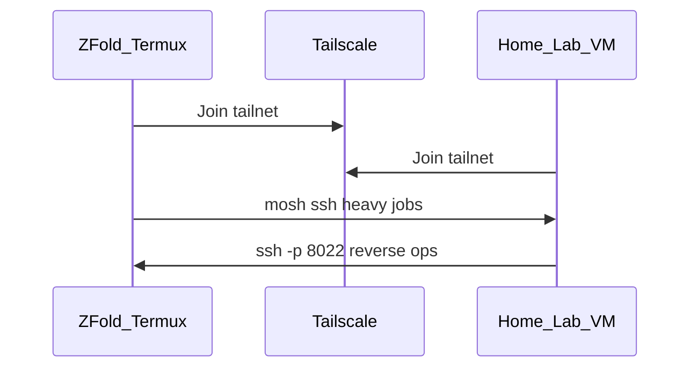

# Lab integrations — Tailscale, SSH, notes sync

## Tailscale mesh

1. Install Tailscale from Play Store (or F-Droid if you prefer).
2. Join the same tailnet as your home lab/VPS.
3. On phone Termux, SSH **out** to lab:

   ```bash
   pkg install mosh openssh -y
   mosh darknight@<lab-tailscale-name>
   ```

4. Laptop → phone: enable `sshd` via bootstrap, connect to phone's Tailscale IP port `8022`.



## WireGuard (alternative)

If you do not use Tailscale, import your lab WireGuard profile in Android VPN settings. Termux traffic respects system VPN.

## Runbook sync (Markor / Obsidian)

**Markor (simple):** clone this repo or sync `docs/mobile/` into `~/storage/downloads/darknight-notes/` after `termux-setup-storage`.

**Obsidian + git:** use separate private vault; copy ROE and engagement logs only. Never commit `loot/`.

Suggested periodic sync:

```bash
cd ~/darknight-hub && git pull --ff-only
```

## Engagement slug alignment

Match leap-of-faith style folders on device:

```
~/darknight/loot/hack-<handle>-<YYYYMMDD>/
  INTENT.md      # paste scope
  PLAYBOOK.md    # steps
  _scratch/      # tool logs
```

## frida-server and ADB

- Frida: `bash mobile/termux/bin/install-frida-server.sh` (downloads release asset; you pick version).
- ADB: enable wireless debugging on **your** test handset; `adb connect <ip>:5555` from Termux.

## Secrets

No API keys in this repo. Store tokens in:

- Android Keystore / password manager
- Tailscale auth via app login
- `~/.netrc` or env files **outside** git with `chmod 600`
